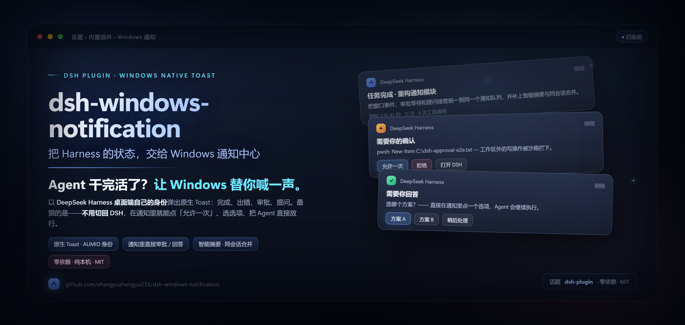
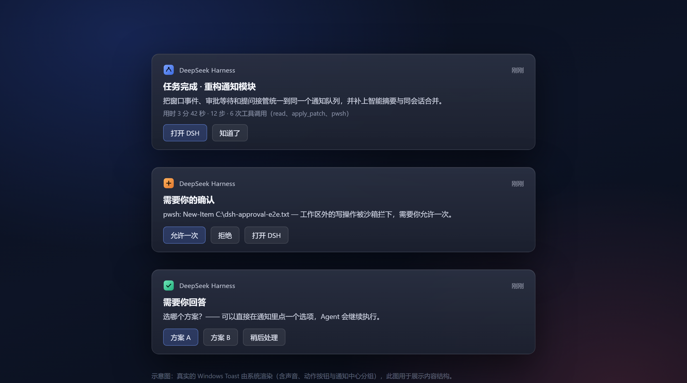
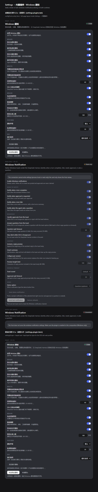

<div align="center">
  
</div>

# dsh-windows-notification

> **Agent 干完活了？让 Windows 替你喊一声。**
>
> 把 DeepSeek Harness 的状态，交给 Windows 通知中心——以桌面端自己的身份弹出原生 Toast；
> 来不及切回 DSH？直接在通知里点「允许一次」、选选项，把 Agent 放行。

[](https://github.com/zhangyuzhangyu233/dsh-windows-notification)
[](https://github.com/topics/dsh-plugin)
[](https://github.com/zhangyuzhangyu233/dsh-windows-notification/releases)
[](LICENSE)
[](#环境和限制)

这是 [DeepSeek Harness](https://github.com/deepseek-ai/deepseek-harness) 的 Windows 原生通知插件。它把 Harness 里值得你抬头看一眼的时刻——**一轮回答完成、需要你确认一次工具调用、Agent 向你提问、一轮任务出错**——变成 Windows 通知中心里的原生 Toast：

**一句话卖点：**

- 💬 **Agent 干完活了？** 让 Windows 替你喊一声——不用一直盯着终端。
- 🖱️ **通知替你按按钮**——审批点「允许一次」，提问直接选选项，人不用切回来。
- 🪶 **零依赖 · 纯本机 · MIT**——只用一个 PowerShell + WinRT，不联网、不要管理员权限。

## 截图





<!-- feature list -->

- **身份正确**：通知以 `DeepSeek Harness` 的应用身份（AUMID `com.deepseek.dsh`）发布，显示 DSH 的名字和图标，而不是「Windows PowerShell」；
- **可以操作**：通知自带按钮——`打开 DSH`、`知道了`，审批通知里的 `允许一次` / `拒绝`，提问通知里直接列出**选项按钮**；
- **通知里直接审批 / 回答**：你不在电脑前时，可以直接在通知里允许/拒绝一次敏感操作，或选择一个回答让 Agent 继续；
- **更聪明的推送**：完成通知带「用时 · 步数 · 工具调用」摘要和清洗过的回复预览；同一会话的新通知会替换旧通知，不在通知中心堆积；错误和提问使用 High 优先级（系统允许时可穿透勿扰）；
- **安静时不打扰**：DSH 窗口在前台时默认不弹通知；系统开着「勿扰」时通知仍然会进入通知中心；
- **自带演示选项**：设置里选一种演示类型、点一下就能看到对应通知（完成 / 审批 / 提问·选项 / 提问·文本），不用等真实事件；
- **即时、低延迟**：设置页的「发送测试通知 / 发送演示通知」不再经过「写配置 → 等插件重新加载」，而是直接调用宿主在本机回环地址上的 `/ui` 通道（毫秒级请求 + 一次 Toast 进程，通常 0.2–0.8 秒出现）；
- **纯本机、零依赖**：不联网、不安装 npm 依赖、不需要管理员权限；通知通过 Windows PowerShell 5.1 的 WinRT API 发布。

```text
DeepSeek Harness
┌──────────────────────────────┐
│  DeepSeek Harness            │  ← 通知身份 = DSH 桌面端本身
│  已回复 · 会话标题           │
│  用时 1 分 12 秒 · 5 步 · …  │
│  回答摘要……                  │
│  [ 打开 DSH ]  [ 知道了 ]    │
└──────────────────────────────┘
```

## 功能

| 事件 | 默认 | 通知内容 | 通知里的操作 |
|---|---|---|---|
| 一轮回答完成 | 开 | 会话标题 + 智能摘要 + 回复预览 | `打开 DSH` / `知道了` |
| 一轮任务出错 | 开 | 会话标题 + `【错误码】` + 摘要 | `打开 DSH` / `知道了` |
| 请求审批（你不在 DSH 前） | 开 | 工具名 + 审批原因 | `允许一次` / `拒绝` / `打开 DSH` |
| Agent 提问（你不在 DSH 前） | 开 | 问题 + 选项概览（或文本输入框） | 选项按钮 / `发送` / `打开 DSH` |
| 演示通知 | — | 由「演示选项」决定四种示例之一 | 对应按钮（演示回执） |

补充行为：

- 子代理（subagent）会话不会触发通知，避免刷屏；同一轮只通知一次；
- 同一会话的完成/错误通知默认**合并替换**（通知中心只保留最新一条）；
- 审批/提问只有在 DSH **不在前台** 时才接管；你在应用里时仍然由应用内 UI 处理；
- 审批 30 秒、提问 60 秒没有回应时自动交回应用内，不会把 Agent 卡死；
- 模型也可以主动调用 `windows_notification` 工具发一条自定义通知。

## 安装

### 从本地目录安装（推荐）

1. 克隆或下载本仓库到任意目录，例如：

   ```bash
   git clone https://github.com/zhangyuzhangyu233/dsh-windows-notification C:/plugins/dsh-windows-notification
   ```

2. 在 DSH 的插件管理里「从本地目录安装」本目录，条目名为 **Windows 系统通知 / Windows Notification**；
3. 在 profile 的 `package.json` 里加入依赖并以 `link:` 方式链接：

   ```json
   { "dependencies": { "dsh-windows-notification": "link:C:/plugins/dsh-windows-notification" } }
   ```

4. 如果 profile 没有自动加载它，把包名加进 `dsh.profile.bundles`，或在本 profile 的 `cordis.patch.yml`
   里插入一行（二选一，同一个 id 只能出现一次）：

   ```yaml
   - insert:
       - id: dsh-windows-notification
         name: dsh-windows-notification
   ```

5. **重启一次 DeepSeek Harness**，刷新页面后在 **设置 → 内置插件 → Windows 通知** 看到配置页
   （旧版 OSS `dsh web` 运行时则是 **设置 → 插件 → 插件配置** 里的卡片）。

### 开发模式

修改插件代码（`index.js` / `client.js`）后需要重启 DSH（或禁用/启用插件一次）才能加载；
修改配置项则会被运行中的实例直接读取（桌面运行时通过 config form 重新应用插件）。


## 设置

桌面端：**设置 → 内置插件 → Windows 通知**；旧版 Web 运行时：**设置 → 插件 → 插件配置**。
字段即时写入 DSH 设置（桌面运行时会重新应用插件），以下为默认值：

| 字段 | 默认 | 说明 |
|---|---|---|
| `enabled` | 开 | 总开关 |
| `onTurnComplete` | 开 | 回答完成时通知 |
| `onApproval` | 开 | 请求审批时通知 / 接管 |
| `onError` | 开 | 任务出错时通知 |
| `onUserQuestion` | 开 | Agent 提问时通知 / 接管 |
| `skipWhenForeground` | 开 | DSH 在前台时不弹自动通知 |
| `includePreview` | 开 | 通知正文带回答摘要 |
| `smartSummary` | 开 | 智能摘要：用时/步数/工具调用 + 清洗后的预览 |
| `sessionCollapse` | 开 | 同一会话的完成/错误通知合并替换 |
| `sound` | 默认 | 通知声音：默认 / 静音 |
| `approvalActions` | 开 | 允许在通知里直接允许/拒绝（仅 DSH 不在前台时接管） |
| `approvalTimeoutSec` | 30 | 审批通知超时秒数（5–300），超时交回应用内 |
| `questionActions` | 开 | 允许在通知里直接回答提问（仅 DSH 不在前台时接管） |
| `questionTimeoutSec` | 60 | 提问通知超时秒数（10–600），超时交回应用内 |
| `maxPreviewChars` | 180 | 摘要最大字符数（40–500） |
| `demoKind` | 提问·选项 | **演示选项**：完成通知 / 审批通知 / 提问·选项 / 提问·文本 |
| `testPing` | 0 | 写入时间戳即触发一条测试通知（由「发送测试通知」按钮使用） |
| `demoPing` | 0 | 写入时间戳即触发演示通知（由「发送演示通知」按钮使用） |

### 演示选项

设置页的「演示」分组里有一个**演示选项**下拉（`demoKind`）和「发送演示通知」按钮：

- **完成通知**：样式同真实完成通知（含操作按钮）；
- **审批通知**：`允许一次` / `拒绝` / `打开 DSH`，点击后回复一条演示回执；
- **提问·选项**：`方案 A` / `方案 B` / `稍后处理`，点击即模拟"在通知里回答选项"；
- **提问·文本**：带文本输入框的提问通知，输入后点「发送」。

演示不会创建真实审批或回答，只用来验证 Windows 通知通道和按钮回环是否正常。
「发送测试通知」则只发一条最简单的连通性通知。

## 通知里的操作是怎么实现的

Windows 对未打包的 Win32 应用提供两种 Toast 激活方式。插件使用 **协议激活（protocol activation）**，不需要 COM 服务、不需要管理员权限：

1. 宿主插件在 `HKCU\Software\Classes\dsh-notify` 注册 `dsh-notify://` 协议，指向插件目录里的 `notify-handler.ps1`；
2. Toast 按钮/正文携带 `dsh-notify://…` URI；
3. 点击通知时 Windows 启动 `notify-handler.ps1`：
   - 读取宿主插件写在 `%LOCALAPPDATA%\dsh-windows-notification\bridge.json` 里的本机回环端口与一次性 token；
   - 把 `open` / `approve` / `deny` / `answer` / `demo` 动作 POST 给宿主插件的本机回环桥；
   - 需要时把 DeepSeek Harness 窗口还原并切到前台。
4. 对于审批/提问，宿主插件在 `approval/request`、`user-questions/request` 瀑布里以 **一次性 id** 等待回环桥的决定；
   超时/取消/异常一律回退到应用内 UI，绝不阻塞 Agent。

安全边界：回环桥只监听 `127.0.0.1`、只接受带 token 的 `POST /action`、决定只接受与待决请求匹配的一次性 id，token 每次启动重新生成，不写日志。

## 为什么通知显示为「DeepSeek Harness」

插件没有用 `powershell.exe` 自己的 AppUserModelID，而是使用 DSH 桌面端在开始菜单里注册的 AUMID：

```text
com.deepseek.dsh
```

因此 Windows 会把通知归到 `DeepSeek Harness` 名下（名字与图标来自 DSH 的开始菜单快捷方式），通知中心里的分组也属于 DSH。

### 关于「勿扰 / 专注助手」

Windows 在开启「勿扰」时不会弹出横幅，但**通知仍会进入通知中心**——这与系统对其它应用（包括 Codex）的行为一致。审批、提问与错误通知会用 High 优先级发送；如果希望它们穿透勿扰，可以在 Windows 设置 → 系统 → 通知 → DeepSeek Harness 中允许它发送 **优先通知**。

## 架构

```text
DSH host（纯 Node，index.js）
  ├─ ctx.on('session/event')        turn/end → 完成/错误通知（智能摘要、同会话合并）
  ├─ ctx.on('approval/request')     审批通知 + 等待回环桥决定（prepend）
  ├─ ctx.on('user-questions/request') 提问通知/选项回答（prepend）
  ├─ 本机 HTTP 回环桥（127.0.0.1 固定候选端口 + token）
  │    └─ /ui/* 即时通道：设置页的「发送测试通知 / 发送演示通知」直接调用（无需重载插件）
  ├─ child_process → toast.ps1      以 AUMID com.deepseek.dsh 显示 Toast
  └─ HKCU 协议注册 → notify-handler.ps1
Windows 通知点击
  → dsh-notify://… → notify-handler.ps1 → 回环桥 / 聚焦 DSH
```

两套运行时都支持：旧 OSS `dsh` 0.1.x（`ctx.settings` 命名空间 + `settingsScope` 卡片）与桌面端 0.2.x
（插件 `Config` + `configForms` 设置页）。

| 文件 | 作用 |
|---|---|
| `index.js` | 宿主插件：事件监听、设置（两套运行时）、回环桥、智能摘要、Toast XML、公开 `Config` |
| `client.js` | 浏览器插件：旧运行时设置卡片 + 桌面运行时「内置插件」设置页 |
| `toast.ps1` | Windows PowerShell 5.1 Toast 发送 / 前台窗口检测 / 优先级 |
| `setup-protocol.ps1` | 注册 `dsh-notify://` 协议（幂等，写用户注册表） |
| `notify-handler.ps1` | 协议激活入口：回环桥动作 + 聚焦/启动 DSH |
| `cordis.patch.yml` | bundle 行与 18 个默认配置 |
| `docs/INTERNALS.md` | 完整的运行时契约（开发/维护用） |

## 验证与证据

以下链路都已在本机真实环境跑过（不是单元测试桩）：

- **身份**：通知以 `com.deepseek.dsh` 写入 Windows 通知中心，通知中心里的应用分组显示 `DeepSeek Harness`（不是 Windows PowerShell）；
- **完成通知**：独立 web 实例里发一条消息，回复结束后 WinRT 历史出现 `turn-done-*`，正文为「任务完成 · 会话标题」+ 摘要，按钮为 `打开 DSH` / `知道了`；
- **通知内审批**：让 Agent 在 workspace 外写文件触发沙箱升级 → 弹出带 `允许一次` / `拒绝` 的通知 → 从通知触发 approve → 回环桥 `200 OK` → Agent 继续执行升级后的命令；
- **协议与回环**：`dsh-notify://` 注册后点击可聚焦/还原 DSH；fake-bridge 测试覆盖 open/approve/deny/answer/demo 的全部 payload；
- **设置页与即时通道**：旧运行时 Web 实例真实渲染卡片；桌面端 0.2.x 运行时用从 `app.asar` 导入的真实 cordis + schemastery 验证了 `Config` 校验、volatile 配置解包与重新应用；`/ui` 通道用真实双实例验证（`GET /ui/health`、`POST /ui/test` 后 WinRT 历史出现「测试通知」、`POST /ui/demo` 四种演示）；
- 自动化测试：宿主 sim **48/48**、真实 cordis 12/12、真实桌面运行时 9/9、`/ui` 真实 smoke 6/6（含 `Origin: dsh-app://app` 预检与真实 Toast）、客户端 harness **49/49**、`node --check` 全绿。

### 诊断（重启后若仍有问题，一条命令定位）

宿主的 `/ui/health` 会返回插件版本、解析后的 18 项配置、待决审批/提问数量、上次 apply 时间和 UI 端口：

```powershell
$bridge = Get-Content "$env:LOCALAPPDATA\dsh-windows-notification\bridge.json" -Raw | ConvertFrom-Json
curl.exe -s "http://127.0.0.1:$($bridge.uiPort)/ui/health"
# 直接触发一条测试通知 / 演示通知（绕过设置页）：
curl.exe -s -X POST "http://127.0.0.1:$($bridge.uiPort)/ui/test"
curl.exe -s -X POST "http://127.0.0.1:$($bridge.uiPort)/ui/demo" -H "content-type: application/json" -d "{\"kind\":\"approval\"}"
```

UI 端口优先 `49514–49522`，本机这些端口被 Windows 保留时自动退到 `49714–49722` 或 `48080–48088`（客户端会并行探测三组）。

复现命令（需要同机 Windows）：

```powershell
# 前台检测（JSON）
powershell -File dsh-windows-notification\toast.ps1 -CheckOnly

# 以 DSH 身份发一条测试通知（XML 由调用方构造）
$xml = '<toast duration="long"><visual><binding template="ToastGeneric"><text>DeepSeek Harness</text><text>测试通知</text></binding></visual><actions><action content="知道了" activationType="system" arguments="dismiss"/></actions></toast>'
$b64 = [Convert]::ToBase64String([Text.Encoding]::UTF8.GetBytes($xml))
powershell -File dsh-windows-notification\toast.ps1 -XmlBase64 $b64 -Tag manual-test

# 查看通知历史（确认身份/内容/按钮）
# [Windows.UI.Notifications.ToastNotificationManager]::History.GetHistory('com.deepseek.dsh')
```

宿主行为契约见 [`docs/INTERNALS.md`](docs/INTERNALS.md)；验证脚本在仓库根目录的 `.verify/notification/` 下。

## 环境和限制

- 仅 Windows 10/11；通知发送依赖 Windows PowerShell 5.1 的 WinRT 投影（系统自带）；
- 改**配置**：桌面运行时即时重新应用；改**插件代码**后需重启 DSH（或禁用/启用插件一次）；
- **延迟**：设置页按钮走 `/ui` 即时通道（本机 HTTP + 一次 Toast 进程，通常 0.2–0.8 秒）；自动事件通知同理，
  不再有「写配置 → 等插件重载」的多秒延迟。若 `/ui` 端口被防火墙/安全软件拦截，按钮会回退到旧配置写入路径（会慢一些）；
- 系统通知被关闭/勿扰时，插件不影响 Harness 正常工作，只是你看不到提醒；审批/提问超时后自动回退到应用内；
- 通知按钮依赖 `dsh-notify://` 协议注册；若注册失败，通知仍会显示，只是按钮点了没反应；
- 提问的「文本输入」依赖 Windows 把 Toast 文本框内容附加到协议 URI（不同 Windows 版本行为可能不同）；
  选项按钮不受影响，文本回答会退化为超时回到应用内。

## 开发

插件没有构建步骤（纯 JS + PowerShell），运行时零 npm 依赖。宿主行为契约见
[`docs/INTERNALS.md`](docs/INTERNALS.md)，验证脚本在仓库根目录的 `.verify/notification/` 下。

## 许可

[MIT](LICENSE)。

---

**English** — Native Windows toast notifications for DeepSeek Harness. The plugin posts turn-complete (with a smart summary), error, approval-request and agent-question notifications under the DSH desktop app's own identity (`com.deepseek.dsh`), with actionable buttons that open the app, answer an approval, or pick a question option straight from the notification. A demo option in settings previews each notification kind. Host half is dependency-free Node ESM supporting both the OSS 0.1.x runtime and the desktop 0.2.x Config/form runtime; the browser half ships an old-runtime settings card and a desktop settings page; PowerShell 5.1 + WinRT handles the transport and a localhost protocol bridge carries clicks back to the host. MIT licensed.
